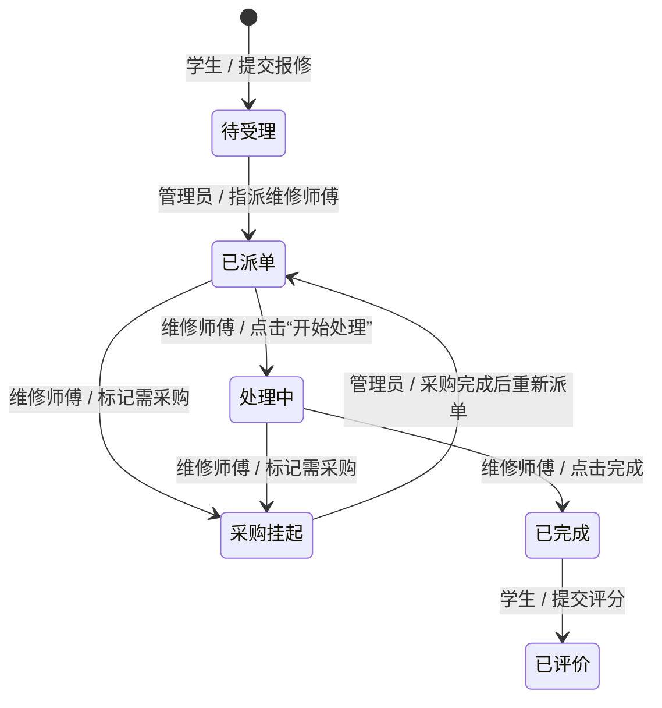

# 《校园报修系统》需求分析报告

> 小组：第 __ 组　　版本：v0.2（小组讨论稿）　　日期：2026-11-20　　执笔：____　　审查：____
>
> **资源约束**：5 人，每人每周约 6 小时，共 2 周，总工时约 60 小时，即 7.5 人日（按 8 小时/人日换算）。Must 类上限为总工时的 60%，即 36 小时或 4.5 人日。
>
> **小组决策状态**：以下 M/S/C/W 和估算是供 5 人小组讨论的建议稿；当前没有小组会议确认记录，不将建议冒充为小组已表决的决定。建议 M 类估算合计 4.5 人日，正好占 60%，剩余 3 人日用于 S 类择优、集成和意外情况。

## 1. 项目背景与目标

学生目前通过电话、宿舍纸质登记本和微信群报修，登记、转抄和派单依赖人工，存在漏单和进度不透明的问题，月度统计也耗时。系统要支持学生提交报修、管理员派单、维修师傅处理，并让学生查看处理进度。系统还需要按访谈和后续确认保护联系方式、处理紧急工单，并支持统计和历史数据导入。项目期望在下学期开学前启用；学校统一身份认证和项目排期依赖校内对接流程。

- **本期 Must 建议范围**：报修提交与受理前修改、管理员派单及进度、师傅维修完成和材料登记、紧急处理、身份与电话访问控制、千人同时使用时 5 秒响应。
- **本期不纳入的内容**：不做师傅抢单；网络问题提示联系网络中心，不创建后勤工单。在线支付、十万并发等没有访谈依据，不列为需求。

## 2. 用户角色

| 角色 | 是谁、有多少人 | 主要诉求 | 能做的操作 |
|---|---|---|---|
| 学生 | 在校生约 12,000 人 | 随时提交报修，知道是否有人接和处理进度；可匿名报修 | 提交及受理前修改报修、查看进度、评价维修 |
| 管理员 | 后勤处物业科约 2 至 3 人 | 派单、跟进工单、查看月度统计 | 查看工单、派单、查看统计和报修身份/联系电话 |
| 维修师傅 | 8 人 | 查看派给自己的工单，维修并记录材料 | 查看当前工单、更新处理、登记材料、标记完成 |

【原话】王老师：“我们学校在校生一万两千人左右，16 栋宿舍楼……维修师傅 8 个人。管理员就我们物业科两三个人。”；“以后系统里应该还是我们管理员来派单。”【用户确认】管理员派单。

## 3. 用户故事清单

估算按人日记录，1 人日按 8 小时换算。估算是两周教学练习的粗估，不是供应商报价或上线承诺。S 类超出 Must 之后的可用余量时，按优先顺序择项。

| 编号 | 用户故事 | 优先级 | 估算（人日） | 估算依据 / 出处 |
|---|---|---:|---:|---|
| US-01 | 作为学生，我想填写楼栋、房间、故障描述和电话提交报修，并可匿名及在受理前修改，以便后勤及时获知问题；遇到 1 天内同楼栋同房间相近问题时，我可以看到提示并决定是否继续，网络问题则得到网络中心提示。 | M | 1.0 | 一个主要提交流程及字段校验；王老师：“哪栋楼、哪个房间，坏了什么东西……还要留个电话。”【用户确认】匿名电话必填、受理前可改、重复报修提示、网络不建后勤工单。 |
| US-02 | 作为管理员，我想把待受理工单派给维修师傅，并让学生看到是否已接、当前处理人和处理阶段，以便工单进度清楚可查。 | M | 0.75 | 一个管理员派单流程及学生进度读取；王老师：“每个单子在谁手上、修到哪一步了，要清清楚楚。”【用户确认】管理员派单。 |
| US-03 | 作为维修师傅，我想登记维修所用材料并将修好的工单标记完成；需采购时可以挂起，采购完成后由管理员重新派单，以便维修过程和月底对账有记录。 | M | 0.75 | 完成、材料记录及采购挂起状态；李师傅：“修完了在手机上点一下‘完成’就行”；“登记一下用了什么材料，月底要对账”；【用户确认】采购期间继续计时、采购后重新派单。 |
| US-04 | 作为管理员和维修师傅，我想优先处理严重漏水、电线冒火花等紧急报修，并在时限内到场或修好，以便减少故障影响。 | M | 0.5 | 紧急和普通时限校验；王老师：“紧急的 2 个小时内必须到场。普通的……三天内修好。” |
| US-05 | 作为学生、管理员和维修师傅，我想通过学校统一身份认证登录，并按角色查看报修身份和电话，以便使用系统并保护学生隐私。 | M | 1.0 | 登录对接及角色可见性；王老师：“最好能和学校的统一身份认证打通，学生用学号登录”；“学生的电话号码不能泄露出去。”【用户确认】启用前接通；匿名身份对师傅隐藏；电话仅管理员和当前处理师傅可查看。 |
| US-06 | 作为学生、管理员和维修师傅，我想在一千人同时使用时完成常用操作且响应不超过 5 秒，以便高峰期仍能使用系统。 | M | 0.5 | 对核心操作做并发性能验证；【用户确认】一千人同时使用、5 秒内响应。 |
| US-07 | 作为管理员，我想按月查看楼栋报修数、类型、平均修复时间、师傅工作量和超时数，以便向处长汇报。 | S | 1.0 | 多维统计和月度口径；王老师：“每个月每栋楼报修了多少……平均多久能修好……每个师傅干了多少活……超时没处理的有多少。”统计从提交开始，结束于师傅点击完成，按提交月份归档。 |
| US-08 | 作为学生和管理员，我想让 AI 根据描述判定报修类别和紧急程度，以便减少错选并及时发现紧急情况。 | S | 1.5 | AI 分类与紧急程度判断、80% 分别验收；王老师：“能不能让 AI 看一下学生写的描述，自动分好类，紧不紧急也判断一下。”【用户确认】判定结果直接生效，类别及紧急程度准确率分别达到 80%；验收使用甲方提供的 100 条脱敏历史报修记录。 |
| US-09 | 作为学生，我想在维修完成后给 1 至 10 分，以便反馈维修情况；管理员只把 3 至 10 分用于师傅考核参考，并结合维修量、时限等信息。 | S | 0.5 | 评分和考核参考记录；【用户确认】评分规则。 |
| US-10 | 作为学生，我想通过扫码进入小程序并上传故障照片，以便更方便地说明问题。 | S | 1.0 | 扫码/小程序入口和图片上传；王老师：“最好是扫个码就能报，做成小程序那种”；“最好能拍个照片。” |
| US-11 | 作为学生，我想在师傅出发时收到通知，以便知道维修人员即将到达。 | S | 0.5 | 发送一次出发通知；小陈：“师傅出发了能通知一下就更好了。”【用户确认】后续可选。 |
| US-12 | 作为管理员，我想导入前两年已有 Excel 记录和已录成 Excel 的去年纸质记录，以便与新工单一起统计。 | S | 1.0 | 文件字段映射和导入；王老师：“去年的纸质登记，大概四千多条，前两年有个学生帮我们录成了 Excel，能不能导进去一起统计？”【用户确认】纸质记录先录入 Excel。 |
| US-13 | 作为管理员，我想下载统计图表或表格并放入 PPT，以便准备月度汇报。 | S | 0.5 | 导出图表或表格；王老师：“最好能出个图，直接放到汇报 PPT 里。”【用户确认】下载图片或表格。 |
| — | Won't：当前没有用户明确提出且小组决定本期不做的需求。未被访谈提出的在线支付、十万并发、紧急 24 小时完成等不作为用户故事。 | W | 0 | 不把没有依据的功能伪装成客户需求。 |

**Must 合计：4.5 人日 = 36 小时 = 总容量 60 小时的 60%。** 剩余 24 小时（3 人日）留给集成、修复和 S 类中经小组同意的少量内容。S 类估算合计 6 人日，无法全部塞进两周，需按总余量选择。实际小组讨论时若 M 估算增加，应先减少 M 范围，使 Must 不超过 36 小时。

## 已确认的状态规则

- **SR-01**：维修师傅点击“开始处理”后，工单从“已派单”转为“处理中”。【用户确认】
## 4. 核心业务流程

### 4.1 报修单状态流转

**不允许的转换（建议规则，需小组/甲方确认）**

| 转换 | 建议不允许的原因 |
|---|---|
| 已完成 → 待受理 | 工单已完成后不应重新回到新报修状态，避免清除既有处理记录。 |
| 已评价 → 处理中 | 已评价表示服务流程结束；如仍需维修，建议新建报修单以保留记录。 |
| 采购挂起 → 已完成 | 采购挂起表示尚待采购和重新派单，不应直接标记为维修完成。 |

**已确认的状态转换**：维修师傅点击“开始处理”后，工单由“已派单”转为“处理中”。访谈没有提出取消工单、退回待受理或完成后返修流程，本图暂不加入这些转换。

### 4.2 关键用例

#### 用例一：学生提交报修

| 项目 | 内容 |
|---|---|
| 用例名称 | 提交报修 |
| 参与者 | 学生、系统 |
| 前置条件 | 学生可打开报修入口；匿名报修仍填写联系电话。 |
| 主流程 | 1. 学生填写楼栋、房间、故障描述和电话。2. 学生可选择匿名并上传照片。3. 系统检查同楼栋、房间 1 天内是否有相近报修。4. 如无相近报修，或学生确认继续，系统创建待受理工单。 |
| 异常/分支流程 | 匿名未填电话：阻止提交并提示补填；重复报修：提示并由学生决定是否继续；网络报修：提示联系网络中心，不建立后勤工单。 |
| 后置条件 | 成功提交的工单状态为待受理；受理前学生可以修改。 |

#### 用例二：管理员派单与师傅处理

| 项目 | 内容 |
|---|---|
| 用例名称 | 派单及处理工单 |
| 参与者 | 管理员、维修师傅、学生 |
| 前置条件 | 工单状态为待受理。 |
| 主流程 | 1. 管理员指派维修师傅。2. 系统记录当前处理师傅并显示已派单。3. 师傅处理报修并登记使用材料。4. 修好后师傅点击完成。5. 学生查看处理进度并可评价。 |
| 异常/分支流程 | 需采购：师傅将工单标记采购挂起；采购等待期间继续计时，采购完成后管理员重新派单。紧急工单立即派单/联系学生，并在 2 小时内到场。 |
| 后置条件 | 维修完成后状态为已完成；学生评分后状态为已评价。 |

## 5. 验收标准（每条 M 类需求）

每个 M 故事至少包含正常流程和三个异常或边界场景；“那么”描述可观察结果。

| 需求编号 | 验收标准（假如—当—那么） |
|---|---|
| US-01 | **正常**：假如学生填写楼栋、房间、故障描述和电话且没有重复报修，当学生提交，那么系统创建状态为“待受理”的工单。 **异常 1**：假如学生选择匿名且未填写电话，当学生提交，那么系统拒绝提交并提示电话必填。 **异常 2**：假如相同楼栋和房间在 1 天内已有相近报修，当学生提交，那么系统显示相近工单提示，并允许学生选择继续或返回。 **异常 3**：假如报修类别为网络问题，当学生提交，那么系统提示联系网络中心且不创建后勤工单。 **边界**：假如工单尚未受理，当学生修改报修内容并保存，那么修改后的字段显示在该工单；受理后修改入口不可用。 |
| US-02 | **正常**：假如工单为“待受理”，当管理员指派维修师傅，那么工单变为“已派单”，并记录被指派师傅。 **异常 1**：假如非管理员尝试派单，当其提交指派操作，那么系统拒绝操作且工单处理人不变。 **异常 2**：假如工单已完成，当管理员再次派单，那么系统拒绝操作且状态保持“已完成”。 **边界**：假如工单已派给师傅甲，当学生查看进度，那么页面显示已派单及当前处理人甲。 |
| US-03 | **正常**：假如工单处于处理中且维修已完成，当师傅点击完成，那么工单状态变为“已完成”。 **异常 1**：假如维修使用了零件，当师傅提交完成登记，那么工单保留所用材料记录。 **异常 2**：假如需要采购，当师傅标记需采购，那么工单状态变为“采购挂起”，时限继续计算。 **边界**：假如采购挂起工单已完成采购，当管理员重新派单，那么工单状态回到“已派单”且记录新的处理人。 **异常 3**：假如工单不处于处理中，当师傅尝试点击完成，那么系统拒绝状态变更。 |
| US-04 | **正常**：假如工单被标记为紧急，当管理员/维修师傅接到通知，那么工单进入紧急处理流程并记录时间。 **边界 1**：假如紧急工单从提交起未满 2 小时，当维修师傅到场并登记，那么系统记录到场时间并显示未超时。 **异常 1**：假如紧急工单超过 2 小时仍未到场，当管理员查看工单，那么系统将该工单计为超时。 **边界 2**：假如普通工单在提交后 3 天内完成，当师傅点击完成，那么系统记录完成时间并显示未超时。 **异常 2**：假如普通工单超过 3 天仍未完成，当管理员查看统计，那么该工单计为超时。 |
| US-05 | **正常**：假如学生持有有效学号且学校认证可用，当学生通过统一身份认证登录，那么系统建立学生登录状态。 **异常 1**：假如认证失败，当学生尝试登录，那么系统不建立登录状态。 **边界 1**：假如工单为匿名且当前处理师傅查看，当师傅打开工单，那么姓名/学号字段不显示。 **边界 2**：假如管理员或当前处理师傅查看工单，当其打开联系方式，那么系统显示联系电话。 **异常 2**：假如非当前处理师傅查看其他师傅的工单，当其请求联系电话，那么系统拒绝查看并不返回号码。 |
| US-06 | **正常**：假如一千名用户同时使用系统，当执行约定的常用报修和查询操作，那么每项被测操作响应时间不超过 5 秒。 **边界 1**：假如并发数为一千，当重复执行报修提交操作，那么被测请求仍在 5 秒内返回结果。 **边界 2**：假如并发数为一千，当重复执行工单进度查询，那么被测请求仍在 5 秒内返回结果。 **异常**：假如任一约定操作响应超过 5 秒，当性能测试记录结果，那么该项判定不通过并记录实际响应时间。 |

## 6. 非功能需求

| 类别 | 需求 | 怎么验证 |
|---|---|---|
| 性能 | 一千人同时使用时，约定的报修提交和进度查询操作均在 5 秒内响应。 | 以一千并发执行报修提交和进度查询，记录每次响应时间；超过 5 秒的请求计为未通过。 |
| 安全/隐私 | 学生电话仅管理员和当前处理该工单的师傅可见；匿名工单姓名/学号对维修师傅隐藏，管理员可查看。 | 使用学生、管理员、当前处理师傅和非当前处理师傅账号检查工单详情字段。 |
| 易用性 | 字体大、操作简单、画面整洁；一个页面最好只有一个功能。 | 由甲方/学生代表按提交报修、查看进度流程走查；不擅自补充访谈未给出的字号数值。 |
| 身份认证 | 学生使用学号登录，系统启用前接通学校统一身份认证。 | 用学校测试账号验证成功和失败登录；检查启用前认证接入完成。 |

## 7. 待甲方确认的问题清单

目前没有待甲方确认的问题。此前的 Q1 已确认：甲方提供 100 条脱敏历史报修记录作为 AI 验收样本，类别准确率和紧急程度准确率分别计算，均须达到 80%。
## 8. 风险与依赖

| 风险/依赖 | 影响 | 应对办法 |
|---|---|---|
| 学校统一身份认证依赖信息中心流程 | 可能影响启用前接通 | 该目标已确认；项目排期应尽早启动校内对接并跟踪进度。 |
| 两周只有约 60 小时总工时 | S 类无法全部实现，集成和返工空间有限 | Must 控制在 36 小时以内；每周检查实际工时，先完成端到端主流程。 |
| AI 准确率验收依赖甲方提供的 100 条脱敏历史报修记录 | 样本缺少人工确认的类别或紧急程度答案时，无法分别计算准确率 | 甲方提供包含标准类别和紧急程度答案的脱敏记录，开发验收使用同一批样本。 |
| 历史 Excel 字段或数据质量不一致 | 可能增加清洗和导入工作量 | 先抽查现有文件格式；历史导入属于 S，超出余量时排至后续。 |

---

**交付前小组检查**：□ 每条故事有原话或用户确认依据　□ M 类总估算不超过 36 小时　□ 每条 M 有正常流程及至少 3 个异常/边界验收场景　□ 状态图标明角色和动作　□ 不允许的状态转换及已确认的状态转换已列出　□ 待甲方问题不超过 2 个。
