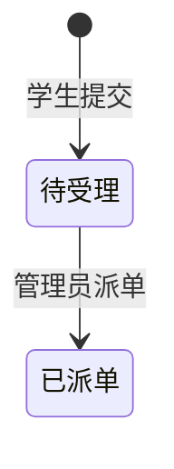

# 《校园报修系统》需求分析报告

> 小组：第 __ 组　　版本：v0.1　　日期：____　　执笔：____　　审查：____
>
> **怎么用这个模板**：每一节都有"写什么"的提示，写完后删掉提示。
> 可以让 AI 帮你起草，但**每条需求都要能在访谈记录里找到出处**；找不到出处的，放进第 7 节"待确认问题"。

---

## 1. 项目背景与目标（3~5 句话，不要写空话）

- 现在的痛点：（例如：电话、纸本、微信群三种渠道报修，经常漏单，月度统计靠手工数）
- 系统要达成的目标：（尽量写成**可衡量**的，例如"报修单 100% 线上留痕，月报统计从半天缩短到一键导出"）
- 本期**不做**的事：（明确写出来，可以防止后面范围越做越大）

## 2. 用户角色

| 角色 | 是谁、有多少人 | 主要诉求 | 能做的操作 |
|---|---|---|---|
| | | | |

## 3. 用户故事清单

格式：**作为**〈角色〉，**我想要**〈做什么〉，**以便**〈得到什么价值〉。

| 编号 | 用户故事 | 优先级（M/S/C/W） | 出处（访谈原话） |
|---|---|---|---|
| US-01 | 作为学生，我想要…，以便… | M | "……" |

> **MoSCoW 优先级**：**M**ust 必须有，没有就不能上线 / **S**hould 应该有 / **C**ould 有更好 / **W**on't 这一期不做
> 经验法则：**M 类加起来不超过总工作量的 60%**，要给意外情况留出余量。

## 4. 核心业务流程

### 4.1 报修单状态流转（用文字或画图描述，可以用 Mermaid）

### 4.2 关键用例（至少写 2 个，"提交报修"必写）

| 项目 | 内容 |
|---|---|
| 用例名称 | 提交报修 |
| 参与者 | |
| 前置条件 | |
| 主流程 | 1. …… 2. …… 3. …… |
| 异常/分支流程 | 例如：描述为空、重复报修、AI 分类服务不可用…… |
| 后置条件 | |

## 5. 验收标准（给每条 M 类需求写）

格式：**假如**〈前提〉，**当**〈操作〉，**那么**〈可观察的结果〉。这就是测试用例的雏形，第 6 周写测试时会直接用到。

| 需求编号 | 验收标准 |
|---|---|
| US-01 | 假如学生已登录，当他填写楼栋、房间、描述并提交，那么系统生成状态为"待受理"的报修单，并返回单号 |

## 6. 非功能需求（必须可度量）

| 类别 | 需求 | 怎么验证 |
|---|---|---|
| 性能 | 例：常用页面在校园网下 2 秒内打开 | 用浏览器开发者工具测 |
| 安全/隐私 | | |
| 易用性 | | |

## 7. 待甲方确认的问题清单

| 序号 | 问题 | 我们的建议方案 | 影响哪些需求 |
|---|---|---|---|
| Q1 | | | |

## 8. 风险与依赖

| 风险/依赖 | 影响 | 应对办法 |
|---|---|---|
| | | |

---

**自查**：□ 每条需求都有出处　□ M 类都写了验收标准　□ 没有"美观""快速"这类没法验收的词　□ 访谈里的矛盾都进了第 7 节
